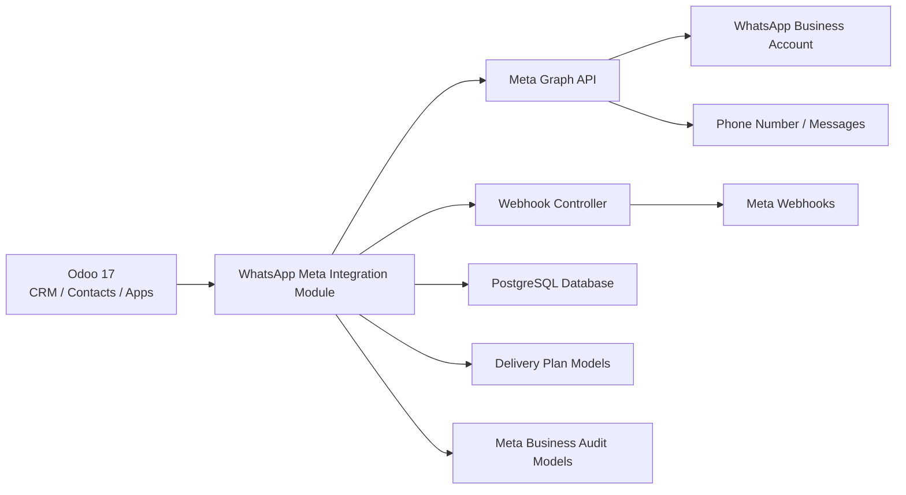

# WhatsApp & Meta Integration for Odoo 17

<p align="center">
  
  
  
  
</p>

A ready-to-run Odoo 17 module that brings WhatsApp Business messaging, Meta Business Manager tracking, and delivery-plan governance into one unified custom app.

## Overview

This project delivers a custom Odoo 17 integration for the WhatsApp Business Platform and Meta ecosystem. It includes:

- WhatsApp message sending and receiving inside Odoo
- Webhook verification and inbound payload processing
- Business portfolio, page, and Instagram account tracking
- Mobile app coexistence tracking for business numbers
- Token, permission, and app review management
- Delivery-plan tracking for phases, deliverables, risks, maintenance, and tests

## Why this project matters

Odoo 17 does not ship with a native WhatsApp app. This module fills that gap by implementing the Meta Cloud API integration directly in Odoo while retaining the project plan's structure and operational controls.

## Architecture



## Core features

- WhatsApp Business Platform integration for inbound and outbound messaging
- Webhook-based event handling and status callback tracking
- Contact, conversation, and message automation inside Odoo
- Meta business metadata: portfolios, pages, and Instagram accounts
- App review, permissions, and token lifecycle records
- Delivery-plan management aligned to project phases and DoD checklists

## Project structure

```text
odoo17_whatsapp_meta_project/
├── addons/
│   └── whatsapp_meta_integration/
│       ├── controllers/
│       ├── data/
│       ├── demo/
│       ├── models/
│       ├── security/
│       ├── tests/
│       ├── views/
│       ├── __init__.py
│       └── __manifest__.py
├── scripts/
│   ├── run_odoo.sh
│   └── setup_env.sh
├── .vscode/
├── odoo.conf.sample
├── README.md
├── .gitignore
└── odoo.conf
```

## Quick start

### 1. Clone Odoo 17

```bash
git clone --depth 1 --branch 17.0 https://github.com/odoo/odoo ~/odoo17
```

### 2. Create a virtual environment

```bash
python3.11 -m venv ~/odoo17-venv
source ~/odoo17-venv/bin/activate
pip install wheel
pip install -r ~/odoo17/requirements.txt
```

### 3. Configure the project

```bash
cp odoo.conf.sample odoo.conf
```

Update the `addons_path` in the config to include the Odoo core addons and the project addon folder.

### 4. Start Odoo

```bash
python ~/odoo17/odoo-bin -c odoo.conf -d whatsapp_odoo17 --dev=all
```

### 5. Install the module

```bash
python ~/odoo17/odoo-bin -c odoo.conf -d whatsapp_odoo17 -i whatsapp_meta_integration --stop-after-init
```

## Windows PowerShell setup

```powershell
cd $HOME
git clone --depth 1 --branch 17.0 https://github.com/odoo/odoo odoo17
py -3.11 -m venv odoo17-venv
.\odoo17-venv\Scripts\Activate.ps1
pip install wheel
pip install -r odoo17\requirements.txt

Copy-Item .\odoo.conf.sample .\odoo.conf
# update addons_path inside odoo.conf

createdb -h localhost -U odoo whatsapp_odoo17
python $HOME\odoo17\odoo-bin -c .\odoo.conf -d whatsapp_odoo17 -i whatsapp_meta_integration --stop-after-init
```

## Development workflow

- Run the server in dev mode:

```bash
python ~/odoo17/odoo-bin -c odoo.conf -d whatsapp_odoo17 --dev=all
```

- Update the module after code changes:

```bash
python ~/odoo17/odoo-bin -c odoo.conf -d whatsapp_odoo17 -u whatsapp_meta_integration --stop-after-init
```

- Run the module tests:

```bash
python ~/odoo17/odoo-bin -c odoo.conf -d whatsapp_odoo17 -u whatsapp_meta_integration --test-enable --test-tags /whatsapp_meta_integration --stop-after-init
```

## Business flows supported

- Send WhatsApp messages from Odoo contacts and conversations
- Receive inbound WhatsApp messages through webhook callbacks
- Track message delivery state from Meta status events
- Maintain Meta account, page, and Instagram records in Odoo
- Review app permissions and token expiry history
- Manage project milestones and test evidence inside Odoo

## License

This project is distributed under the LGPL-3 license.

## Contributing

Pull requests are welcome. Please keep the module aligned with the Odoo 17 compatibility and maintain the existing delivery-plan structure when adding features.
